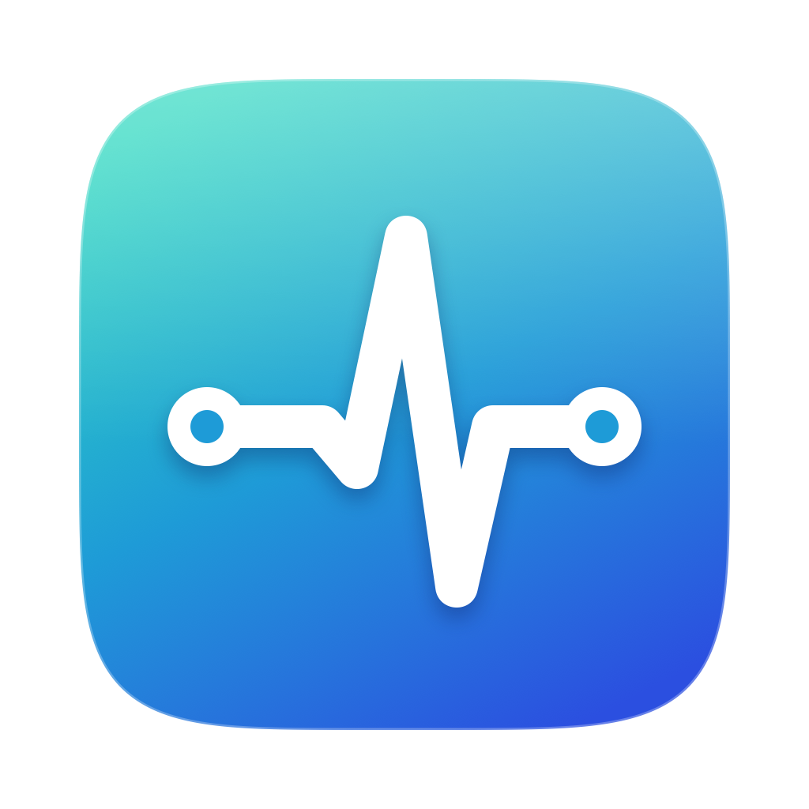
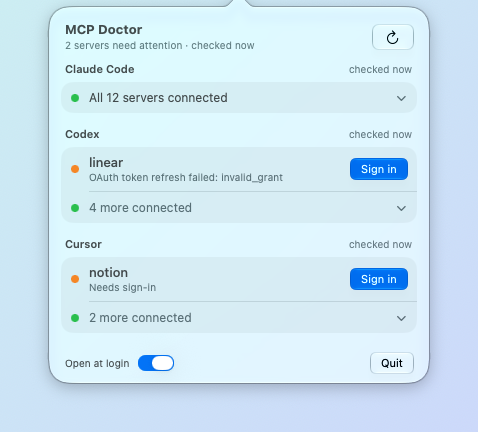

<p align="center"></p>

# MCP Doctor

A macOS menu bar app that tells you when an MCP server in Claude Code, Codex or Cursor needs you
to sign in again, before an agent finds out halfway through a thread. It lets you sign in from the
menu bar.

- The icon turns orange and shows a count when something needs attention.
- The panel always lists Claude Code, Codex and Cursor, so you can tell "all good" from "not
  checked". Problems come first with a **Sign in** button; a summary row such as "All 21 servers
  connected" expands to show the rest.
- Organisation-provisioned claude.ai connectors that have never worked on this Mac are collapsed
  and don't count. Any server can be muted from its context menu.

<p align="center"></p>

## Requirements

- macOS 26 or later on Apple Silicon.
- Xcode 26 or later, or the Command Line Tools with Swift 6.2 or later, to build it.
- Any of the harnesses below. Harnesses you don't use show as not installed.

| Harness | Tested with | Needs |
|---|---|---|
| Claude Code | 2.1.310 | `claude mcp list` and `claude mcp login` |
| Codex CLI | 0.164.0 | `codex app-server` with `mcpServerStatus/list`, and `codex mcp login` |
| Cursor CLI (`cursor-agent`) | 2026.10.19 | `cursor-agent mcp list` and `cursor-agent mcp login` |

Older versions may lack some of these. When that happens, the panel says which harness to update
instead of showing a raw error.

## Install

Clone the repository, then from its folder:

```sh
scripts/install.sh
```

This builds the app (about a minute), copies it to `~/Applications` and starts it. Because it's
built on your Mac, Gatekeeper doesn't block it. Turn on **Open at login** in the panel to keep it
running.

## How it works

MCP Doctor asks each harness's own CLI rather than re-implementing OAuth. Harnesses refresh tokens
themselves with their own locking, and MCP Doctor never writes credentials. It never calls an AI
model, so it uses none of your plan's usage.

| Harness | Health check | Between checks | Sign-in |
|---|---|---|---|
| Claude Code | `claude mcp list` (~6 s) | watches `~/.claude.json` and `~/.claude/mcp-needs-auth-cache.json`; reads token expiry from the `Claude Code-credentials` Keychain item | `claude mcp login <name>` |
| Codex | `codex app-server` → `mcpServerStatus/list` (~2 s) | watches `~/.codex/config.toml` | `codex mcp login <name>` |
| Cursor | `cursor-agent mcp list` (~2.5 s), run from your home folder | watches `~/.cursor/mcp.json` and the token file | `cursor-agent mcp login <name>` |

Checks run one at a time at background priority: Codex every 10 minutes, Cursor and Claude Code
every 15. Claude Code's check runs with larger connection batches
(`MCP_SERVER_CONNECTION_BATCH_SIZE`), which cuts it from ~24 s to ~6 s with ~60 servers. Checks
also run after wake, when the network comes back, and when you open the panel with stale data.
Config changes are picked up within seconds. Checks pause while offline, and intervals double in
Low Power Mode. With the panel closed the app uses under 20 MB of memory and no CPU between checks.

If a login command needs a real terminal, right-click a server and choose **Sign In Using
Terminal**.

### Privacy

- MCP Doctor has no telemetry. Nothing leaves your Mac except what the harness CLIs themselves
  send to your MCP servers.
- Claude Code's Keychain item is read through `/usr/bin/security`, so Keychain access doesn't
  depend on this app's code signature. Only `serverName`, `expiresAt` and whether a refresh token
  exists are kept; tokens are discarded immediately. If macOS asks whether `security` may access
  the item, choose **Always Allow**.
- Your login-shell environment is captured once, kept in memory only, and passed to the harness
  CLIs so they find their stdio servers.

## Known limitations

- **Only servers available everywhere are checked.** Checks run from your home folder, so servers
  configured for a single project (a repo's `.mcp.json` or `.cursor/mcp.json`, or Claude Code's
  per-project servers) aren't listed.
- **Cursor answers differently per folder.** In folders where `cursor-agent` has never run, it
  reports OAuth servers as needing sign-in even when your saved login works. MCP Doctor checks from
  your home folder.
- **Claude Code and Cursor are read from their text output.** A new version that changes the
  format will show "Couldn't read the output" until the parser is updated. Codex returns JSON.
- **Some servers don't issue refresh tokens.** Their sign-in lasts as long as one access token, so
  they will keep coming back. That needs fixing on the server.

## Development

```sh
scripts/build-app.sh            # build "build/MCP Doctor.app"
scripts/test.sh                 # run the tests
swift scripts/make-icon.swift   # redraw Resources/AppIcon.icns and docs/icon.png
swift scripts/screenshot.swift  # retake docs/screenshot.png from demo data (after build-app.sh)
```

The app takes a few flags:

- `--dump` prints what the panel would show and exits, which is useful for bug reports:
  `swift build && .build/debug/MCPDoctor --dump`.
- `--demo` shows made-up servers instead of yours, without saving anything.
- `--show-panel [--expanded]` opens the panel at launch, optionally with every harness expanded,
  and keeps it open.

The code is split in two:

- `Sources/MCPDoctorCore` has no UI: one adapter per harness (`Adapters/`), the process runner,
  and the logic that merges check results with local signals. It's what the tests cover.
- `Sources/MCPDoctor` is the menu bar app: the scheduler, file watchers and SwiftUI panel.

To support another harness, add a case to `Harness` and a type conforming to `HarnessAdapter`,
then register the adapter in `Doctor.standard()`. The compiler points out the remaining switches,
such as the harness's check interval in `Scheduler`.

### Command Line Tools only

The Command Line Tools ship without SwiftUI's `@State` macro plugin. The app keeps view state in
`@Observable` objects instead, so it builds either way. `scripts/test.sh` points SwiftPM at the
Swift Testing plugin, which is installed but not found automatically.

## License

[MIT](LICENSE)
